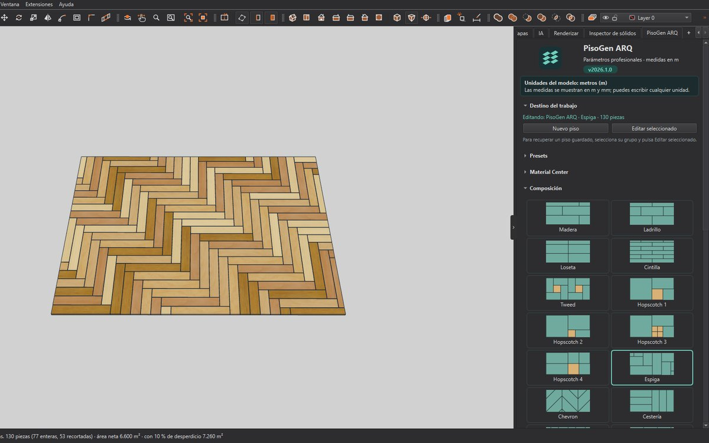

# PisoGen ARQ para INGETRAZO

**Español** · [English](#english) · [Português](#português)

Generador de pisos para [INGETRAZO](https://ingetrazo.com): seleccionas una cara y PisoGen ARQ la cubre con piezas reales, cada una con su junta, bisel, textura y cantidades.

- **Veinte composiciones:** Madera, Ladrillo, Loseta, Cintilla, Tweed, Hopscotch 1 a 4, Espiga, Chevron, Cestería, Hexágono, Octágono, Adopasto, Adopasto Reja, Irregular, Cuña, Bloque I y Diamantes.
- **Medidas y juntas:** junta y junta de testa, espesor, largos variables, desnivel entre piezas y recorte mínimo junto a bordes y huecos.
- **Nivel del piso:** al nivel de la cara elegida (la losa baja el espesor del piso) o sobre la cara.
- **Acabado:** bisel superior, relleno de juntas, materiales de la biblioteca de INGETRAZO, textura por pieza o continua.
- **Cantidades:** área, piezas enteras y recortadas, desperdicio, cajas, precio, adhesivo y boquilla.
- **Presets y Material Center**, deshacer en un solo paso y edición posterior del piso.

Probado en INGETRAZO 0.5.11 para Windows.

## Instalar

Desde INGETRAZO: **Extensiones › Gestionar extensiones › Explorar › PisoGen ARQ › Instalar**.

A mano: descarga `pisogen_arq-2026.1.0.zip` de [Versiones](https://github.com/ark-rdz/pisogen-arq-ingetrazo/releases), abre **Extensiones › Abrir carpeta de extensiones**, copia ahí la carpeta `pisogen_arq` y reinicia INGETRAZO. El panel está en **Extensiones › PisoGen ARQ › Panel PisoGen ARQ**.

## Manual

[Manual completo en PDF](manual/Manual_PisoGen_ARQ_INGETRAZO.pdf), en español.

## Licencia

© 2026 Alfonso Rodríguez. Software libre bajo la licencia [GPL-3.0-or-later](LICENSE), sin garantía.

---

## English

Floor generator for [INGETRAZO](https://ingetrazo.com): select a face and PisoGen ARQ covers it with real pieces, each with its joint, bevel, texture and quantities. Twenty compositions (wood, brick, tile, herringbone, chevron, hexagon, grass pavers, irregular stone and more), joint fill, top bevel, per-piece textures, a floor level that lowers the slab by the floor's depth, quantities, presets and a material catalog. Tested with INGETRAZO 0.5.11 on Windows. The interface and the manual are in Spanish.

Install from **Extensions › Manage extensions**, or copy the `pisogen_arq` folder from the release ZIP into the extensions folder and restart INGETRAZO. Free software under GPL-3.0-or-later.

## Português

Gerador de pisos para [INGETRAZO](https://ingetrazo.com): selecione uma face e o PisoGen ARQ a cobre com peças reais, cada uma com junta, bisel, textura e quantidades. Vinte composições, rejunte, bisel superior, texturas por peça, nível do piso que rebaixa a laje, quantitativos, presets e catálogo de materiais. Testado no INGETRAZO 0.5.11 para Windows. A interface e o manual estão em espanhol. Software livre sob GPL-3.0-or-later.
